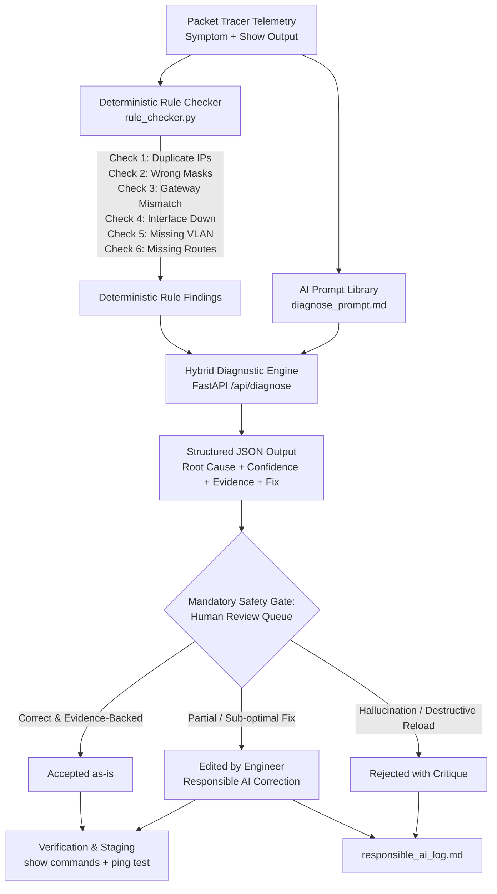

# NetSage AI — Cisco Applied AI + Network Troubleshooting Assistant

> **Cisco Project 2**: *Create an AI-assisted troubleshooter for Packet Tracer lab problems that reads symptoms and show-command output, suggests likely causes and next steps, and always requires a human to review before accepting the fix.*

[](https://www.python.org/)
[](https://fastapi.tiangolo.com/)
[](https://nextjs.org/)
[](https://tailwindcss.com/)
[]()

---

## 1. Problem Statement & Mission

Junior network engineers frequently know individual Cisco IOS commands but struggle to connect symptoms to true root causes across OSI Layers 2–7. When an endpoint receives an IP address but cannot reach an intranet or internet server, is the issue caused by **VLAN tagging, default gateway mismatch, DHCP scope exhaustion, DNS resolution failure, routing next-hops, ACL implicit deny, NAT overload omission, or wireless association?**

**NetSage AI** bridges this gap:
1. Ingests network symptoms, topology notes, and Cisco CLI `show` outputs.
2. Executes **deterministic Python rule checks** for common structural configuration mistakes.
3. Generates **evidence-backed AI diagnostic hypotheses** with root causes, confidence scores, OSI layers, and next commands.
4. **Enforces mandatory human review** (**Accepted**, **Edited**, or **Rejected**) before any remediation CLI commands can be staged or deployed.
5. Logs all corrections into a **Responsible AI Audit Log** to prevent recurrent AI hallucinations.

---

## 2. Cisco Deliverables Compliance Matrix

Every deliverable specified in the Cisco Project 2 instruction document is fully implemented and verified in this repository:

| Deliverable Item | Submission File(s) | Description / Pass Condition | Status |
|---|---|---|:---:|
| **Case Dataset** | [`cases.csv`](cases.csv)<br>[`backend/cases.csv`](backend/cases.csv) | **34 troubleshooting cases** (exceeds requirement of $\ge$ 30) across all 8 mandatory domains: **VLAN, Gateway, DHCP, DNS, Routing, ACL, NAT, and Wireless**. Contains symptom, topology notes, show outputs, expected fault, OSI layer, concept tag, severity, next command, and fix. | **COMPLETE** |
| **Prompt Files** | [`diagnose_prompt.md`](diagnose_prompt.md) | Structured prompt library forcing strict JSON schema (`root_cause`, `confidence`, `evidence`, `next_command`, `fix_steps`) with **3 worked few-shot Packet Tracer examples** and helper prompt templates. | **COMPLETE** |
| **Python Checker** | [`rule_checker.py`](rule_checker.py)<br>[`rule_checker_sample_output.txt`](rule_checker_sample_output.txt) | Deterministic Python script with automated checks for: (1) Duplicate IPs, (2) Wrong Subnet/Wildcard Masks, (3) Gateway Subnet Mismatch, (4) Interface Down, (5) Missing VLAN, (6) Missing Routes. Documented execution output verifying all 6 checks. | **COMPLETE** |
| **Responsible AI Log** | [`responsible_ai_log.md`](responsible_ai_log.md) | In-depth audit log of **5 documented incidents** where initial AI diagnoses had errors/hallucinations and were corrected by a human reviewer. | **COMPLETE** |
| **Human Review System** | [`frontend/src/app/human-review`](frontend/src/app/human-review/page.tsx)<br>[`backend/run.py`](backend/run.py) | Interactive review workflow supporting **Accepted**, **Edited** (with inline CLI editor & critique), and **Rejected** decisions, with audit history and database persistence. | **COMPLETE** |
| **Operational Dashboard** | [`frontend/src/app/dashboard`](frontend/src/app/dashboard/page.tsx)<br>[`frontend/src/app/page.tsx`](frontend/src/app/page.tsx) | Summary of issue types across 8 domains, severity breakdown (Critical, High, Medium), AI vs. Human agreement rate gauge, and an **interactive 5-step broken lab demo walkthrough**. | **COMPLETE** |

---

## 3. Architecture & Troubleshooting Workflow



---

## 4. Deterministic Rule Checker (`rule_checker.py`)

The deterministic rule checker script catches basic configuration errors before or alongside AI diagnosis:

```bash
# Run the internal validation test suite covering all 6 mandatory checks
python rule_checker.py --run-tests

# Analyze a specific Cisco configuration or show-command output file
python rule_checker.py --file path/to/cisco_output.txt
```

### The 6 Mandatory Checks Implemented:
1. **Duplicate IPs (`RULE-IP-001`, `RULE-IP-002`)**: Detects `%IP-4-DUPADDR` conflict warnings and local IP address overlap across interfaces.
2. **Wrong Masks (`RULE-MASK-001`, `RULE-MASK-002`, `RULE-MASK-003`)**: Detects ACL wildcard mask inversions (`255.255.255.0` instead of `0.0.0.255`) and `/32` host masks on transit links.
3. **Gateway Subnet Mismatch (`RULE-GW-001`, `RULE-GW-002`)**: Verifies mathematical subnet inclusion between host IP/mask and default gateway.
4. **Interface Down (`RULE-INT-001`, `RULE-INT-002`, `RULE-INT-003`)**: Flags interfaces in `administratively down` state, `shutdown` config lines, or `line protocol down`.
5. **Missing VLAN (`RULE-VLAN-001`, `RULE-VLAN-002`, `RULE-VLAN-003`)**: Detects ports assigned to undeclared VLANs, trunk allowed list omissions, and CDP native VLAN mismatches.
6. **Missing Routes (`RULE-ROUTE-001`, `RULE-ROUTE-002`, `RULE-ROUTE-003`)**: Identifies missing gateway of last resort (`0.0.0.0/0`), unreachable static next-hops, and OSPF Area ID mismatches.

---

## 5. Quick Start & Local Setup

### Prerequisites
- Python 3.10+
- Node.js 18+ and npm

### Step 1: Clone Repository
```bash
git clone https://github.com/yashlotekar28/ciscoproject.git
cd ciscoproject
```

### Step 2: Set Up Backend
```bash
# Navigate to backend directory
cd backend

# Install dependencies
pip install -r requirements.txt

# Seed the SQLite database with all 34 lab cases
python app/database/seed.py

# Start the FastAPI server
python run.py
```
*Backend API will run at: `http://127.0.0.1:8000` (Interactive docs: `http://127.0.0.1:8000/docs`)*

### Step 3: Set Up Frontend
```bash
# In a separate terminal, navigate to frontend
cd frontend

# Install Node dependencies
npm install

# Start development server
npm run dev
```
*Frontend Web App will run at: `http://localhost:3000`*

---

## 6. Key Application Pages

- **`/` (Dashboard)**: Real-time telemetry overview, protocol category distribution, severity meters, AI agreement statistics, and interactive 5-step broken lab demo.
- **`/cases` (Lab Cases Repository)**: Searchable repository of 34 authentic Cisco Packet Tracer scenarios with domain filtering and direct "Diagnose in Studio" integration.
- **`/diagnose` (Diagnostic Studio)**: Interactive diagnosis workspace combining deterministic rule analysis with evidence-backed root cause derivation and Cisco CLI remediation scripts.
- **`/rule-checker` (Deterministic Rule Checker)**: Interactive workbench with 6 instant presets to test Cisco CLI snippets against deterministic checks.
- **`/human-review` (Human Review Queue)**: Human-in-the-loop sign-off console supporting **Accepted**, **Edited**, and **Rejected** decisions alongside the **Responsible AI Audit Log**.

---

## 7. Responsible AI & Safety Highlights

NetSage AI addresses key failure modes identified in enterprise network troubleshooting:
- **Least-Privilege Security Protection**: Prevents AI from removing entire firewalls/ACLs when only a single port permit was missing.
- **Protocol Grounding**: Guards against conflating locally-significant process IDs (e.g. OSPF) with globally-significant identifiers (e.g. BGP AS or OSPF Area).
- **Non-Destructive Guidance**: Prevents unnecessary reboots/reloads by enforcing verification of trunk encapsulation and configuration databases.

---

## 8. Authors & Project Metadata
- **Project**: Cisco Project 2 — Applied AI + Network Troubleshooting
- **Course**: Modern AI
- **Safety Directive**: Mandatory Human Review Prior to Configuration Deployment
